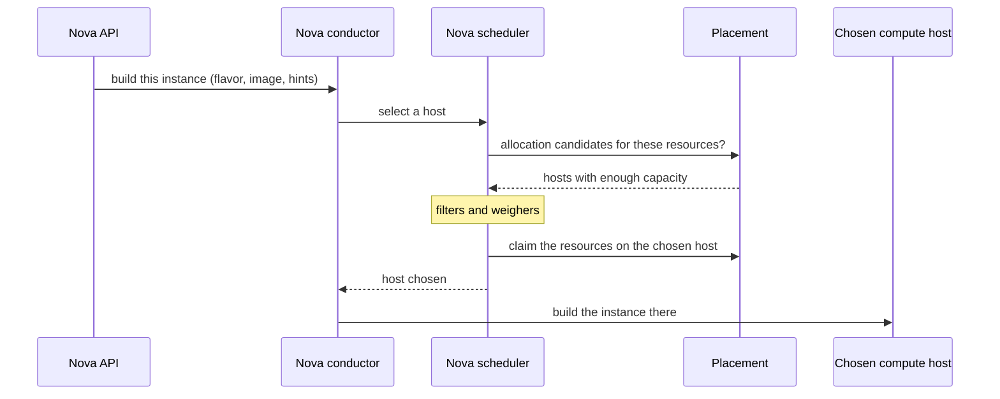

# 6. The resource register and the choice of a host

*The inventory room next to the workshops.*

Next to the workshops, Noor keeps a large register in a brass frame. For each workshop it says how many tools it has,
how many are already in use, and what is special about it: a fast disk here, a particular processor there. "I count,"
Noor says. "I don't choose."

Choosing is Sacha's job. When a request comes in, Sacha asks Noor which workshops have enough room, then looks at the
rest: this house must not share a workshop with that one, this one needs the fast disk, this one must stay in the
northern quarter. Sacha weighs the candidates, keeps one, and Noor writes down what is now taken, so that nobody else
gets the same tools.

LUMO had imagined the village simply picking the emptiest workshop. It is more careful than that.

> [!IMPORTANT]
> **Where the picture stops.** It is not "find the emptiest field". Constraints, policies and capacity all count, and
> the operators can change how hosts are filtered and weighed. Placement records what exists and what is used; it does
> not decide alone.

## What it is in OpenStack

- **Placement** is a service that tracks **resource providers** (for example each compute host), their
  **inventories** (vCPU, memory, disk…), their **traits** (capabilities such as a CPU feature or an SSD) and the
  **allocations** that consume them.
- The **Nova scheduler** handles each request to create or move an instance. It asks Placement for **allocation
  candidates** that have enough of each resource, then applies **filters** (availability zone, affinity rules,
  aggregates…) and **weighers** to pick a host. The resources are then **claimed** in Placement.
- If no host passes, the instance fails with the well-known `No valid host was found`.

## From the village to OpenStack



## See it for real

Operator rights and the `osc-placement` plugin of the client are needed:

```bash
openstack resource provider list
openstack resource provider inventory list <PROVIDER_UUID>
```

**The lantern:** the beam picks out several candidates without naming a winner before the request is made.

**Next:** Neri must now say what the house should contain and how big it should be.
[7. An image and a flavor →](07-an-image-and-a-flavor.md)
