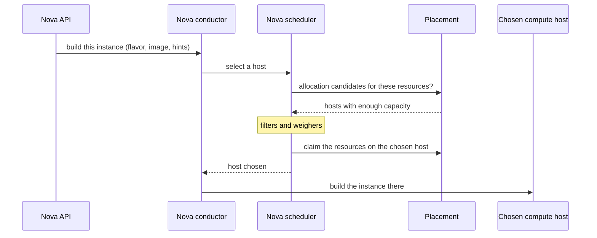

# 6. The resource register and the choice of a host

*The inventory room next to the workshops.*


Next to the workshops, Noor keeps a large register in a brass frame. For each workshop it says how many tools it has,
how many are already in use, and what is special about it: a fast disk here, a particular processor there. "I count,"
Noor says. "I don't choose."

Choosing is Sacha's job. When a request comes in, Sacha asks Noor which workshops have enough room, then looks at the
rest: this house must not share a workshop with that one, this one needs the fast disk, this one must stay in the
northern quarter. Sacha weighs the candidates, keeps one, and Noor writes down what is now taken, so that nobody else
gets the same tools.


LUMO had imagined the village simply picking the emptiest workshop. It is more careful than that.


> [!IMPORTANT]
> **Where the picture stops.** It is not "find the emptiest field". Constraints, policies and capacity all count, and
> the operators can change how hosts are filtered and weighed. Placement records what exists and what is used; it does
> not decide alone.

## What it is in OpenStack

- **Placement** is a service that tracks **resource providers** (for example each compute host), their
  **inventories** (vCPU, memory, disk…), their **traits** (capabilities such as a CPU feature or an SSD) and the
  **allocations** that consume them.
- The **Nova scheduler** handles each request to create or move an instance. It asks Placement for **allocation
  candidates** that have enough of each resource, then applies **filters** (availability zone, affinity rules,
  aggregates…) and **weighers** to pick a host. The resources are then **claimed** in Placement.
- If no host passes, the instance fails with the well-known `No valid host was found`.

## From the village to OpenStack



## See it for real

Operator rights and the `osc-placement` plugin of the client are needed:

```bash
openstack resource provider list
openstack resource provider inventory list <PROVIDER_UUID>
```

**On a real host.** The inventory is not always the hardware. For each resource, Placement offers
`(total - reserved) * allocation_ratio`. `reserved` keeps some for the host itself: `reserved_host_memory_mb` is
512 MB by default. `allocation_ratio` is the overcommit factor set by the operator in Nova's configuration
(`cpu_allocation_ratio`, `ram_allocation_ratio`, `disk_allocation_ratio`): `ram_allocation_ratio` starts at 1.0, so
memory is not overcommitted unless somebody raises it, and a ratio above 1.0 lets the instances together be promised
more than the host has. This is also why quotas (scene 4) can add up to more than the hosts can run. To read the real
numbers of one host, use `openstack resource provider list --name <compute>` and then
`openstack resource provider inventory list <PROVIDER_UUID>` (columns `total`, `reserved`, `allocation_ratio`).
With Kolla-Ansible's defaults, a libvirt compute keeps Nova's own: when the host is first registered, its CPU ratio
is 4.0 and its RAM and disk ratios are 1.0 (Nova 2026.1, `initial_cpu_allocation_ratio` and the like; Kolla-Ansible
22.2.0 sets the RAM ratio and the reserved memory only for Ironic). Nova counts the host's logical CPUs: 16 logical
CPUs give 64 vCPUs, and a 16-core host with hyperthreading on, as most servers ship, shows 32 and so offers 128.
`cpu_shared_set` and `cpu_dedicated_set` change that count. This is read from the code, not measured on the lab,
and an operator may have changed the ratios: read them on your hosts. To go further: [No valid host with free capacity](../runbooks/scheduling/no-valid-host-with-free-capacity/) and
[Instance shut off by the host OOM killer](../runbooks/lifecycle/instance-shut-off-by-host-oom-killer/), section "Why
the host runs out of memory".

**The lantern:** the beam picks out several candidates without naming a winner before the request is made.

**Next:** Neri must now say what the house should contain and how big it should be.
[7. An image and a flavor →](07-an-image-and-a-flavor.md)
