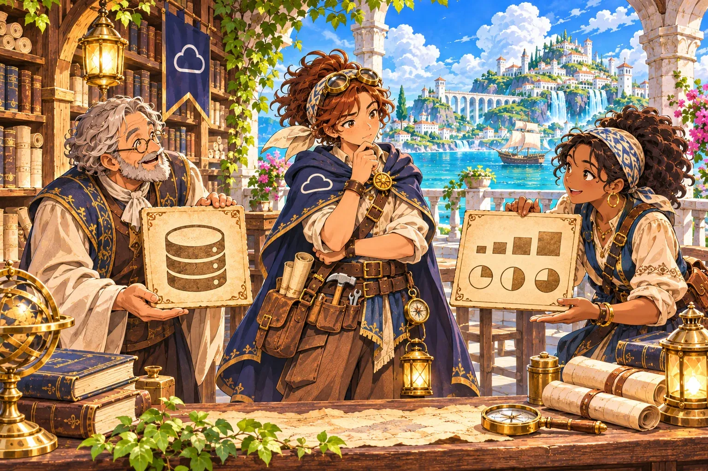
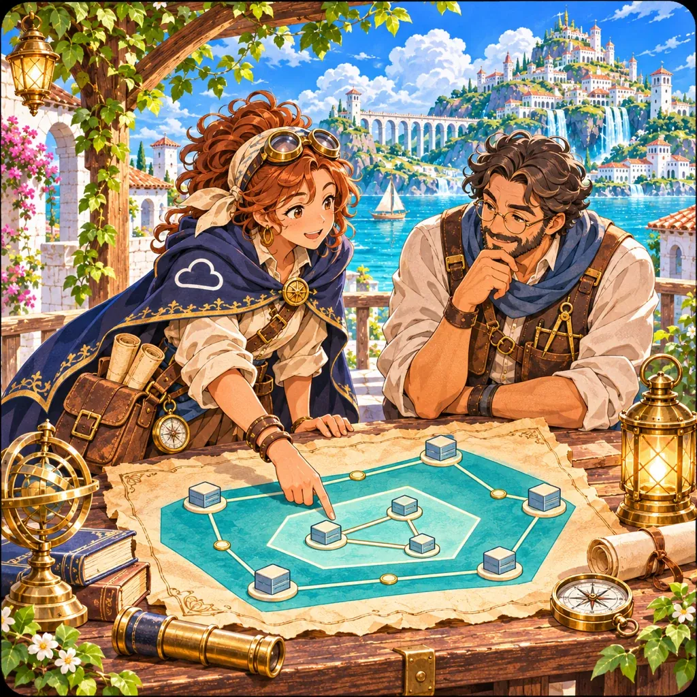
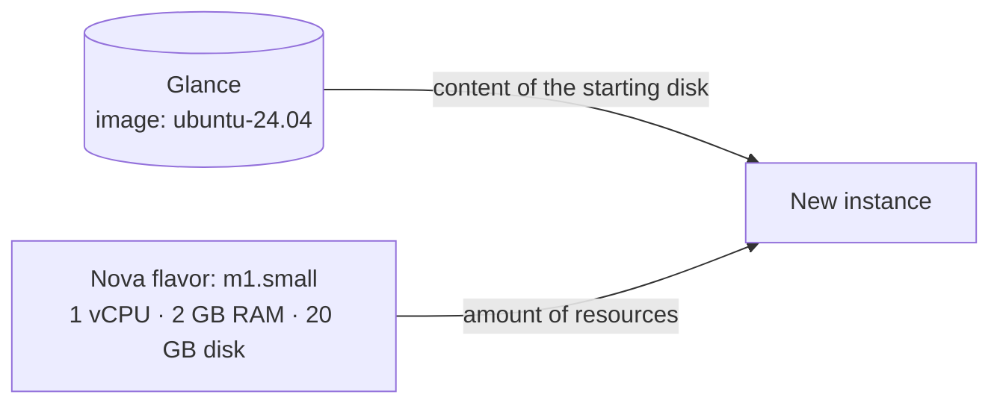

# 7. An image and a flavor

*The image library and the profile table.*



Jae's library is full of disk tiles, each one the starting content of a house: the floor, the walls, the furniture
already in place. "Pick one," Jae says, "and I will give the workshop a copy. I never hand out a house that is
already lived in. Just the content to start from."

Across the room, on a long table, lie the profiles: small, medium, large. Each says how many processors, how much
memory and how much disk a house will get. LUMO picks up a tile with one hand and a profile with the other, and is
careful not to mix them up. "What is in it" and "how big it is" are two different questions.


Neri chooses a small, plain tile and a small profile. It will do for a first service.



> [!IMPORTANT]
> **Where the picture stops.** An image is not a running instance. A flavor is neither an operating system image nor a
> floor plan. And what happens to the disk depends on how the instance boots: from a local copy of the image, or from
> a volume.

## What it is in OpenStack

- **Glance** stores and serves **images**: files that contain the content of a starting disk (an operating system,
  sometimes with software already installed), in a format such as QCOW2 or RAW, with properties.
- A **flavor** is a Nova object that describes the size of an instance: vCPUs, RAM, root disk, ephemeral disk, swap,
  and optional extra specs (for example CPU pinning). It is what the scheduler asks Placement for.
- To create an instance you need both: the image says what it starts with, the flavor how much it gets.

## From the village to OpenStack



## See it for real

```bash
openstack image list
openstack flavor list
```

**On a real host.** The compute does not keep a fresh full copy for each instance: with the default local store it
caches the base image and each instance disk is a `qcow2` overlay on it. Scene 9 shows where, with links.

**The lantern:** the light falls on two objects that are clearly not the same.

**Next:** what is in it and how big it is are settled. Before building, the house needs a road.
[8. The network and its attachments →](08-the-network-and-its-attachments.md)
