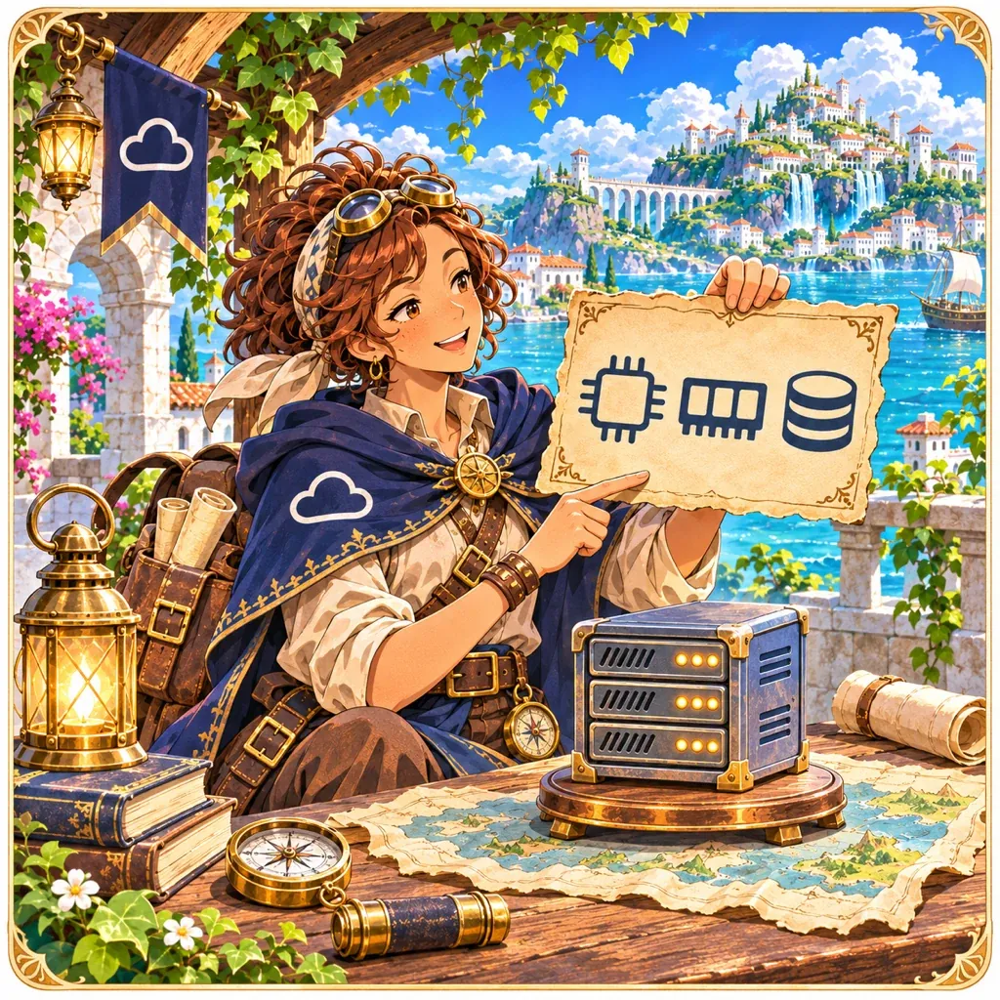
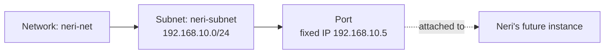

# 8. The network and its attachments

*The network workshop.*


Linh's workshop smells of fresh rope and brass. On the bench lies a thin line that will become Neri's road: a private
network, just for Neri's project. Linh gives it a range of addresses, like house numbers along a street that does not
exist yet.

"And how does the house get onto the road?" LUMO asks. Linh holds up a small wooden and brass connector. "With one of
these. Each house that joins the network gets its own connector, with its own number from the range. Take the
connector away, and the house is off the road."



LUMO notices that nothing here is dug into the ground. The road is drawn on paper, and the workshops will carry it for
real wherever the houses happen to be.


> [!IMPORTANT]
> **Where the picture stops.** These objects are logical. A subnet is not a plot of land; a port is an interface
> attached to a resource, not a physical socket. The same network can span many hosts.

## What it is in OpenStack

**Neutron** is the networking service. Its three basic objects:

- A **network** is an isolated layer-2 segment, usually private to a project (built over VXLAN or Geneve tunnels, or
  over a VLAN, depending on the cloud).
- A **subnet** is a range of IP addresses on that network (a CIDR such as `192.168.10.0/24`), with a gateway, DNS
  servers and DHCP settings.
- A **port** is a connection point on a network: it has a MAC address and one or more **fixed IPs** from a subnet. An
  instance gets one port per network it is attached to.

## From the village to OpenStack



## See it for real

```bash
openstack network create <NET>
openstack subnet create --network <NET> --subnet-range <CIDR> <SUBNET>
openstack port list
```

**On a real host.** The Academy's default Kolla-Ansible platform uses ML2/OVS (Neutron's Open vSwitch driver, with its
own agents). There, `openstack network create` makes no Linux object by itself: it writes records in Neutron's
database. Objects appear where something uses the network. When an instance starts on a compute, its port is plugged
into the Open vSwitch bridge `br-int` of that compute (a `qvo<port-id prefix>` interface with the iptables firewall
described in scene 11). On the network hosts, the DHCP agent runs one `qdhcp-<network-id>` namespace per network. You
can look, read-only, with `ip netns list | grep qdhcp-` on a network host and `ovs-vsctl show` inside the
`openvswitch_db` container. These names are specific to ML2/OVS: ML2/OVN builds logical switches and flows instead.
To go further: [Open vSwitch logs](../runbooks/logs/open-vswitch-logs/) (tap and `qvo` names, how to match them to a
port) and [ML2/OVS versus ML2/OVN](../deploy/comparisons/ml2-ovs-versus-ml2-ovn-with-kolla-ansible/).

**The lantern:** the beam follows a thin link between the workshop and the house that will be built.

**Next:** the road is ready. LUMO can now ask for the house.
[9. Neri's first house →](09-neris-first-house.md)
