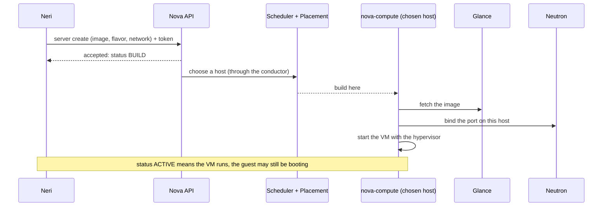

# 9. Neri's first house

*A compute workshop.*

Everything is ready: the tile from the library, the small profile, the connector on Neri's road. LUMO hands the three
to Rami at the workshop desk and signs the request with Maë's token. Rami checks the request, Sacha picks a workshop,
Noor writes down the tools it will use, and in the chosen workshop the foreman starts the build.

A few minutes later a small house stands in the workshop, connected to Neri's road. Rami's board turns from *building*
to *active*. Neri claps. LUMO keeps the lantern steady. "Active means the house is standing and powered. It doesn't
tell us yet that your service inside is running. Let's look."

Neri opens the console of the house: the system inside is still starting. Two minutes later it is up.

> [!IMPORTANT]
> **Where the picture stops.** `ACTIVE` does not guarantee that the guest operating system or the application works:
> it only says what Nova did. And whether the disk survives the deletion of the instance depends on how it booted: a
> disk created from the image on the host is deleted with the instance; a volume can outlive it.

## What it is in OpenStack

An **instance** (or *server*) is a virtual machine created by **Nova** from:

- an **image** (what the disk starts with) or a bootable volume,
- a **flavor** (how much CPU, memory and disk),
- one or more **networks** or ports (where it is connected),
- optionally a key pair, security groups, user data, and more.

Nova authenticates the request, schedules it (scene 6), and asks `nova-compute` on the chosen host to create the
virtual machine with the hypervisor, after Neutron has bound its port and Glance has provided the image. The instance
goes through states such as `BUILD`, then `ACTIVE`, or `ERROR` if something failed.

## From the village to OpenStack



## See it for real

```bash
openstack server create --image <IMAGE> --flavor <FLAVOR> --network <NET> <SERVER>
openstack server show <SERVER>
openstack console log show <SERVER>
```

`server show` gives the status and the fixed IP; the console log shows whether the guest has finished booting.

**The lantern:** steady on the first house. It does not promise that the house will always be available.

**Next:** the house is on Neri's private road. How does anyone from outside reach it?
[10. The bridge to the outside →](10-the-bridge-to-the-outside.md)
