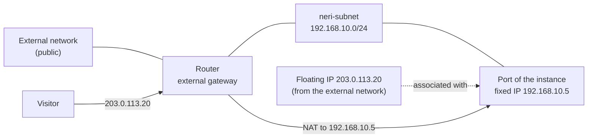

# 10. The bridge to the outside

*The gateway on the sea side.*


Neri's house stands on a private road that no ship can see. Down by the sea, Linh shows LUMO a small bridge: a router.
One side joins Neri's road, the other the big public quay where visitors arrive.

"A visitor can't use the private house number," Linh explains. "On the quay we hand out public numbers. You take one,
and you tie it to the connector of the house." LUMO ties a public number to Neri's house. From the quay, the house now
has an address; on the private road it keeps its own.


Neri asks if visitors can come in now. LUMO looks at the doors of the house. "There's a way in. Whether the doors
let them through is another matter."


> [!IMPORTANT]
> **Where the picture stops.** The floating IP is different from the fixed internal IP: the instance itself only
> knows its fixed IP, and the router translates between the two. Associating a floating IP does not by itself give
> access: routes and security group rules must also allow the traffic.

## What it is in OpenStack

- A **router** (a Neutron object) connects subnets to each other and, through its **external gateway**, to an
  **external network** (a provider network that reaches the outside world).
- A **floating IP** is an address taken from the external network and associated with a **port** of an instance. The
  router performs the address translation (NAT) between the floating IP and the port's fixed IP.
- Outgoing traffic from instances without a floating IP usually leaves through the router with the router's own
  external address (source NAT).

## From the village to OpenStack



## See it for real

```bash
openstack router create <ROUTER>
openstack router set --external-gateway <PUBLIC_NET> <ROUTER>
openstack router add subnet <ROUTER> <SUBNET>
openstack floating ip create <PUBLIC_NET>
openstack server add floating ip <SERVER> <IP>
```

**The lantern:** the beam points at two different addresses and at the bridge between them.

**Next:** the bridge exists. LUMO checks which crossings are allowed.
[11. The rules at the doors →](11-the-rules-at-the-doors.md)
