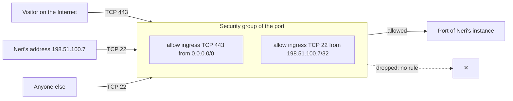

# 11. The rules at the doors

*The board of network rules.*


On a board next to Linh's workshop hang the rules of each door. By default Neri's house lets its own people go out
and lets nobody in. A visitor who crosses the bridge reaches the door and stops there.

LUMO reads Neri's needs again: the service answers on one port, and Neri wants to log in to look after it. So LUMO
adds exactly two rules: let in the web traffic of the service, and let in remote login, but only from Neri's own
address. Nothing else.


"Why not open everything? It would be simpler," Neri asks. LUMO shields the flame from the wind. "Every open door is a
door someone else can use. We open what the service needs, and we write down why."


> [!IMPORTANT]
> **Where the picture stops.** Security groups are not physical fences or guards. They are rules applied to each
> port by the virtual network. A rule that is too broad (for example SSH open to `0.0.0.0/0`) can expose a service to
> the whole Internet.

## What it is in OpenStack

- A **security group** is a named set of **rules** applied to the **ports** of instances. Each port can have several
  groups.
- Each rule allows traffic: a direction (ingress or egress), a protocol, a port range, and a remote source (an IP
  range or another security group). Anything not allowed is dropped.
- They are **stateful**: if an incoming connection is allowed, its replies go out without an extra rule, and the
  other way round.
- The `default` group of a project allows all outgoing traffic and incoming traffic only from members of the same
  group.

## From the village to OpenStack



## See it for real

```bash
openstack security group list
openstack security group rule list <SG>
openstack security group rule create --protocol tcp --dst-port 443 --remote-ip 0.0.0.0/0 <SG>
```

**The lantern:** the beam narrows onto the openings that are actually needed.

**Next:** the network is under control. LUMO turns to where the data lives.
[12. The attached disk and the object archive →](12-the-attached-disk-and-the-archive.md)
