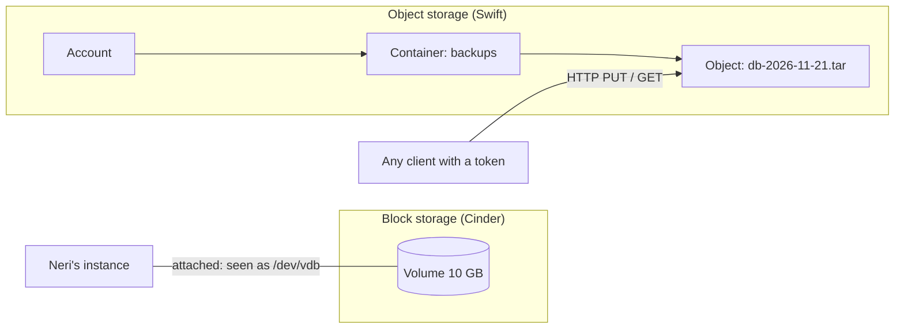

# 12. The attached disk and the object archive

*Two separate storerooms.*

Neri's service will keep data, and LUMO does not want it to live only inside the house. In the first storeroom Safa
hands over a removable plate: a volume. LUMO fixes it to Neri's house, where it appears as an extra disk. "If the house
is rebuilt, you detach the plate and fix it to the new one," Safa says. "And if you delete the plate, it is gone, so
check its life cycle too."

In the second storeroom, Eren keeps an archive of labelled boxes. Neri drops a file in a box called `backups`. Eren
writes down its name and hands back nothing more than the promise to return it when asked by name. "You don't mount
this in your house," Eren says. "You ask me for an object, and I give it to you, from anywhere."

Two halos, two kinds of storage. LUMO is careful to keep them apart.

> [!IMPORTANT]
> **Where the picture stops.** A volume can be deleted on its own, and it does not automatically survive every kind
> of deletion (deleting a volume deletes its data). A Swift object is not a disk mounted in the instance: it is read
> and written through an HTTP API, from anywhere that can reach it.

## What it is in OpenStack

- **Cinder** provides **block storage**: **volumes** that are attached to an instance and appear to its operating
  system as a disk (`/dev/vdb`). A volume exists independently of the instance, can be detached and attached
  elsewhere, snapshotted or backed up. The data lives on a storage back end such as Ceph, LVM or a storage array.
- **Swift** provides **object storage**: an **account** holds **containers**, which hold **objects** (files with
  metadata). Objects are written and read whole, through an API, and Swift replicates them across its storage nodes.

## From the village to OpenStack



## See it for real

```bash
openstack volume create --size 10 <VOL>
openstack server add volume <SERVER> <VOL>
openstack container create <CONTAINER>
openstack object create <CONTAINER> <FILE>
```

The last two need Swift on the cloud and the Swift client support of the `openstack` client.

**The lantern:** two separate halos, one on an attachable volume, one on an archived object.

**Next:** after the resources themselves, LUMO compares the ways of asking for them.
[13. Three windows on the same services →](13-three-windows.md)
