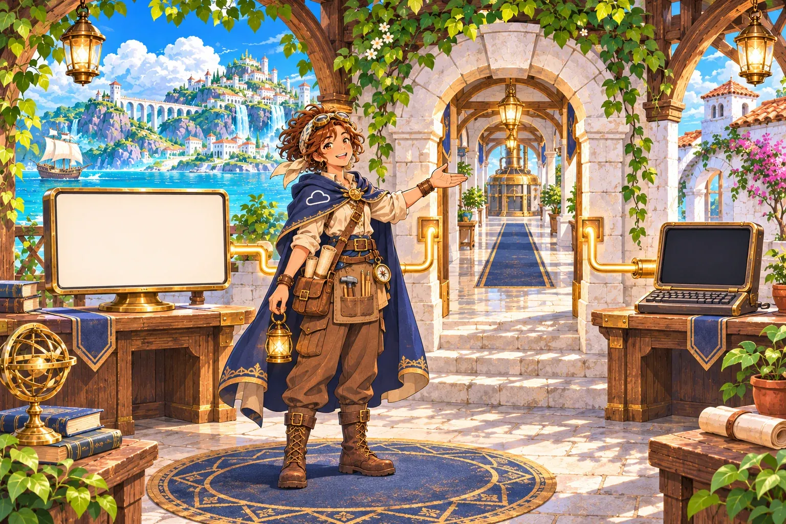
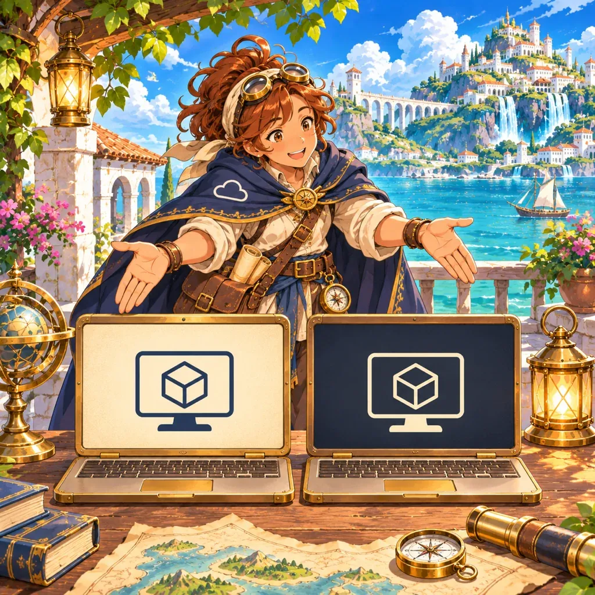
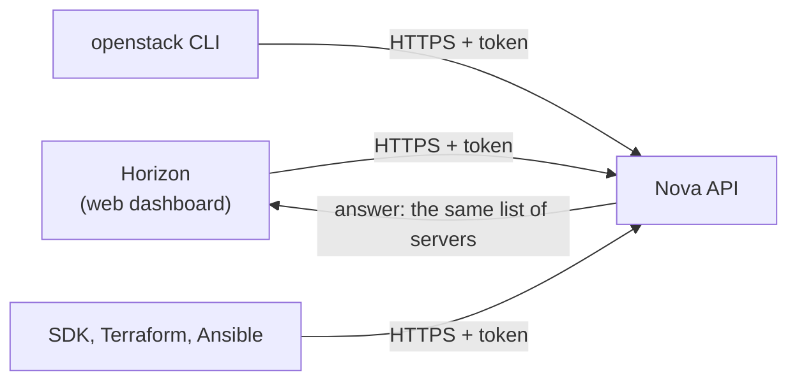

# 13. Three windows on the same services

*The Horizon front desk and the command-line table.*



At the front desk of the town hall, Imani shows Neri a large, clear board: the list of Neri's houses, their status,
their addresses, a button to build another. Neri likes it at once.

At the back of the room LUMO sits at a plain table and types a short line. The same list appears, as text. Behind
both, a third window that nobody looks at directly: the town hall's own counters, where every request really goes.



"Which one is the real one?" Neri asks. "All three ask the same counters," Imani says. "I just make it easier to
fill in the form."


> [!IMPORTANT]
> **Where the picture stops.** Changing the client does not change the service being asked. The rights and the
> answers depend on the cloud: if your role does not allow an action, no window will let you do it.

## What it is in OpenStack

- Every OpenStack service exposes a **REST API** over HTTP. That is the only way to talk to it.
- **Horizon** is the web dashboard: a client that calls those APIs for you.
- The **`openstack` command-line client** (OSC) is another client, convenient for scripts and repeatable work.
- SDKs (such as `openstacksdk` in Python) and tools such as Terraform or Ansible are clients too.

All of them authenticate with Keystone, read the catalog and send the same API calls.

## From the village to OpenStack



## See it for real

In Horizon: **Project → Compute → Instances**. On the command line:

```bash
openstack server list
openstack server list --debug
```

`--debug` shows the actual API requests the client sends, and the endpoint from the catalog it sends them to.

**The lantern:** one light joins three windows to the same set of services.

**Next:** LUMO wants to see what lets the services of the town hall work together.
[14. Behind the town hall →](14-behind-the-town-hall.md)
