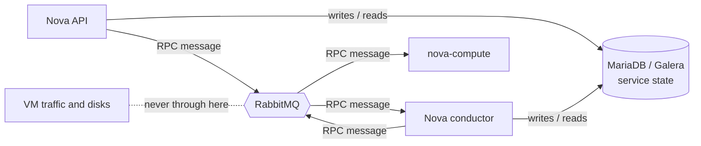

# 14. Behind the town hall

*The service corridor.*

Behind the offices runs a narrow corridor that visitors never see. Pax hurries along it with sealed capsules:
messages from one office to another. "Build this house." "That house is ready." "This workshop is still alive." Pax
does not read them and never carries the visitors themselves. Pax carries the town hall's own mail.

At the end of the corridor Talia keeps the closed registers of every office: which houses exist, on which roads,
with which connectors, in whose file. "If these were lost, the houses would still stand," Talia says, "but the town
hall would no longer know they are there." The operators check on Pax and Talia every morning, before anything else.

> [!IMPORTANT]
> **Where the picture stops.** These components do not hold the disks of the virtual machines or their traffic. They
> hold the state and the internal messages of the control plane. Their exact role, and how they are made highly
> available, depend on the architecture that was deployed.

## What it is in OpenStack

- A **message queue**, usually **RabbitMQ**, carries remote procedure calls and notifications between the parts of a
  service, for example from the Nova conductor to `nova-compute`, or from the Neutron server to its agents.
- A **SQL database**, usually **MariaDB** with **Galera** clustering in production, stores the state of each service:
  instances, networks, ports, volumes, projects, and so on. Each service has its own database.
- **Memcached** often caches tokens and other short-lived data.

When RabbitMQ or the database is in trouble, the whole control plane is in trouble. Several of the
[VM runbooks](../runbooks/) start there.

## From the village to OpenStack



## See it for real

These are operator views, on the controllers of a Kolla-Ansible deployment:

```bash
docker ps --filter name=rabbitmq --filter name=mariadb
docker exec rabbitmq rabbitmqctl cluster_status
docker exec mariadb mysql -u root -p -e "SHOW STATUS LIKE 'wsrep_cluster_size';"
```

Use `podman` instead of `docker` if your deployment runs Podman. The last command asks for the database root password
of the deployment.

**The lantern:** it lights the corridor without suggesting that one component explains everything.

**Next:** further down, specialised workshops add more to the village.
[15. The specialised workshops →](15-the-specialised-workshops.md)
