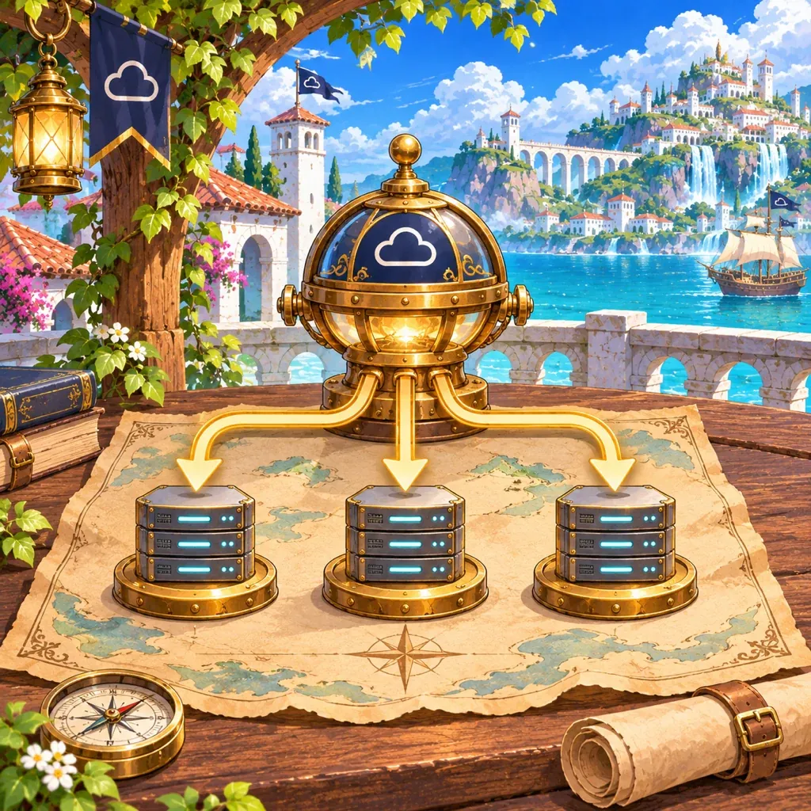
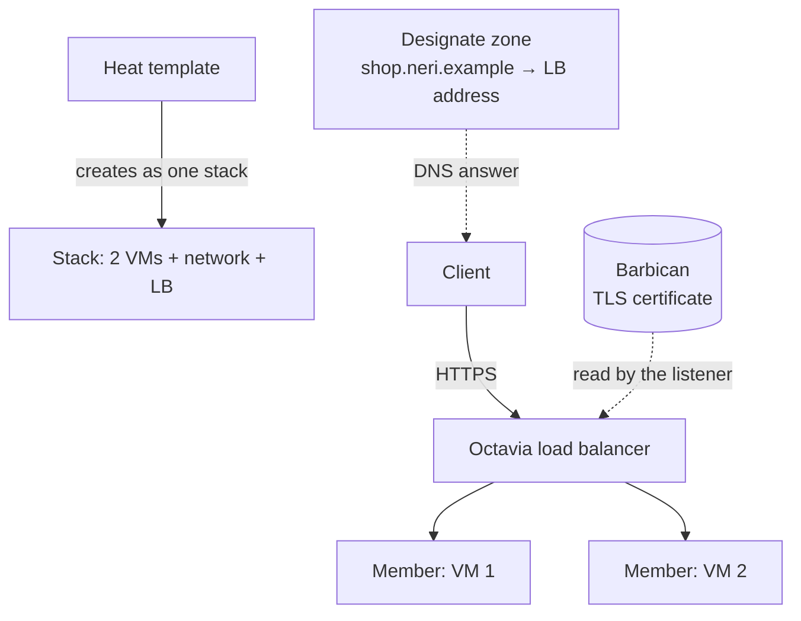

# 15. The specialised workshops

*The gallery of additional services.*


At the end of the main street, four smaller workshops stand side by side. Not every village has all of them; this
one does.

Aster lays tiles on a table, linked by threads: two houses, a road, a bridge, a public number. "Give me the plan, and I
build the whole quarter in the right order, and take it down the same way." Farah stands at a switch with several
tracks: "When one house is not enough, I send each visitor to one of several houses, and I stop sending them to a house
that doesn't answer." Taro keeps a sealed box: certificates and passwords that services need but nobody should leave
lying around. Ina hangs name rings on posts: visitors can ask for `shop.neri.example` instead of a number.


LUMO looks at each in turn and does not mix them up: four tools, four jobs.



> [!IMPORTANT]
> **Where the picture stops.** These services are optional. Whether a cloud offers them, and how they behave, depends
> on what the operators enabled, the plugins and back ends they chose, and the policies they set.

## What it is in OpenStack

- **Heat** is orchestration: a **template** (HOT, in YAML) describes a set of linked resources, a **stack**, that Heat
  creates, updates and deletes together, in dependency order.
- **Octavia** is load balancing as a service: a **load balancer** with **listeners** and **pools** of **members**,
  with health monitors that take failing members out.
- **Barbican** is the key manager: it stores **secrets** (keys, certificates, passphrases) and controls who may read
  them. Other services, such as Octavia for TLS or Cinder for encrypted volumes, use it.
- **Designate** is DNS as a service: **zones** and **record sets** that it publishes to real DNS servers.

## From the village to OpenStack



## See it for real

Each command needs the service on the cloud and its plugin in the `openstack` client:

```bash
openstack stack list
openstack loadbalancer list
openstack secret list
openstack zone list
```

**The lantern:** four small beams pick out four different tools without merging them.

**Next:** LUMO climbs to the lookout to see the village as a whole.
[16. The village runs. What now? →](16-the-village-runs.md)
