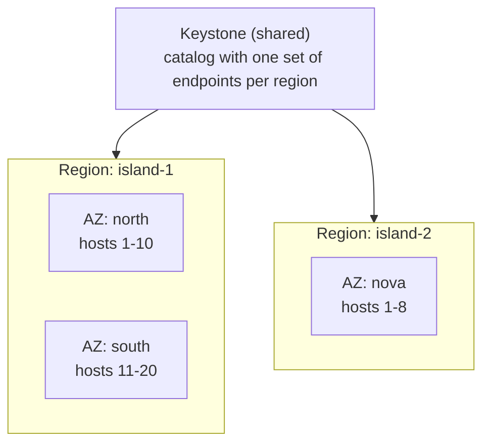

# 16. The village runs. What now?

*The lookout above the archipelago.*

From the lookout the whole village is visible: the town hall, the workshops on their terraces, the roads, the bridge,
the storerooms. Far across the water, another village with its own town hall serves the next island. On the terraces
below, the workshops are grouped in quarters, each with its own water supply and its own path down to the quay.

"So if one quarter loses its water, the houses in another quarter keep going?" Neri asks. LUMO hesitates. "Only if
the quarters were really built that way. A name on a sign doesn't tell you. You have to look at how they were built,
and test it."

The sky darkens over the sea: a storm is announced for tomorrow. Nothing is broken, but Neri is worried. LUMO opens
the notebook. "Then let's practise. Not here, on the real houses. In a small village of our own, where we can break
things on purpose and learn to repair them."

The lantern is small, but steady. It lights the road down to the harbour.

> [!IMPORTANT]
> **Where the picture stops.** The name of a region or an availability zone is not enough to know its topology or its
> resilience. An availability zone does not by itself guarantee high availability: you have to look at the real
> architecture and the real procedures, and test them.

## What it is in OpenStack

- A **region** is a separate OpenStack deployment with its own endpoints in the catalog, often in another location.
  Regions usually share Keystone; each has its own compute, network and storage services. You choose a region when you
  make a request.
- An **availability zone** (AZ) is a group of hosts inside a region that the operators define, ideally with
  independent power, network or racks. Users can ask for an instance in a given AZ. Compute, block storage and
  networks each have their own notion of AZ.
- High availability comes from the design and from how your service is spread and tested, not from the labels.

## From the village to OpenStack



Whether `north` and `south` fail independently depends on how their power, network and storage were built.

## See it for real

```bash
openstack region list
openstack endpoint list
openstack availability zone list --compute
```

In Horizon, the region selector is at the top of the page when the cloud has several regions.

**The lantern:** small but steady, it lights the road to the lab and to the archipelago.

## The road goes on

The village answers its inhabitants. Now the question is: how do you break it and repair it safely? That is the next
stop: the [Quick lab](../lab/), a real, disposable OpenStack in about an hour, with exercises to break and repair it.

Further on, the book [*OpenStack, the Day After Tomorrow*](https://book.ozarland.com/) follows LUMO across the
archipelago, from a platform nobody fully understands to one a team can run for the long term.

[← Back to the village](index.md)
