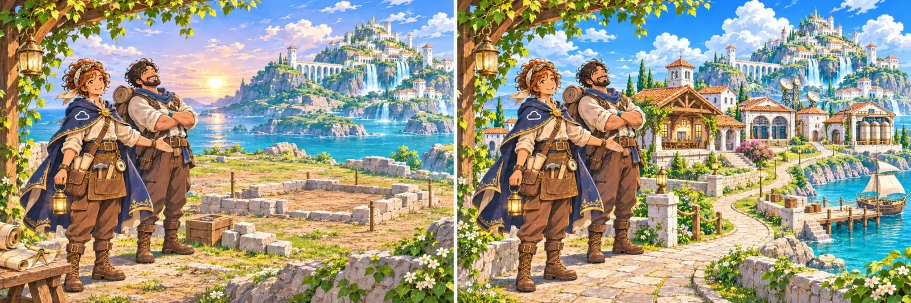
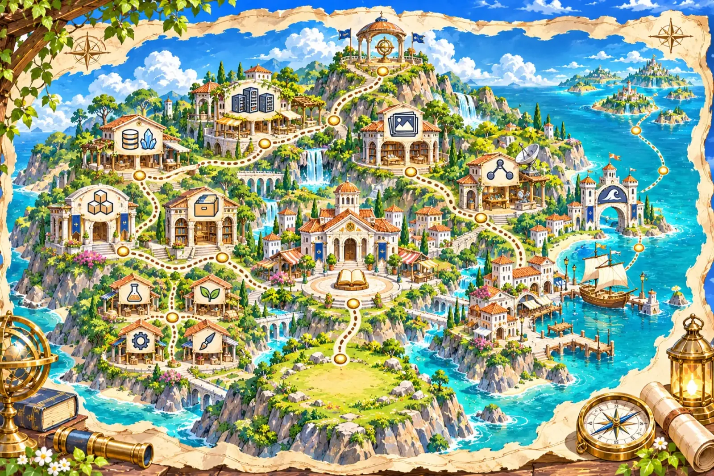
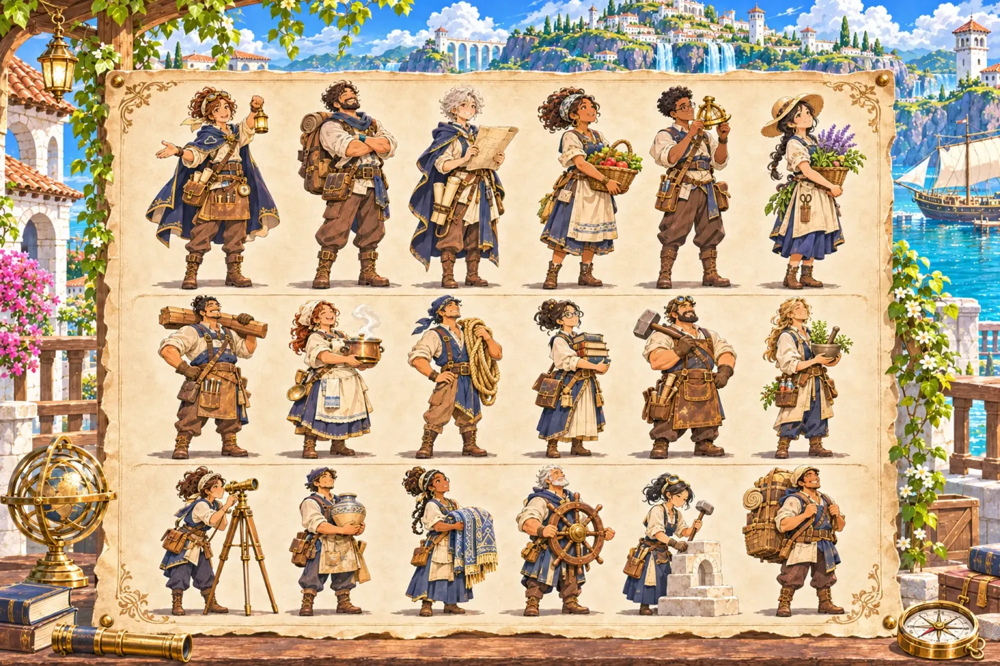
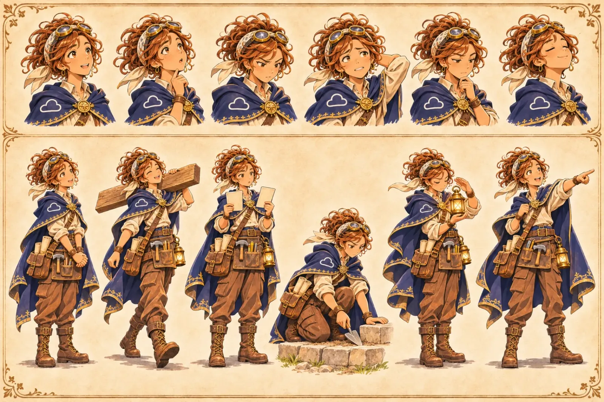

# 🏘️ LUMO's village

**Before the lab, a story.** LUMO, an apprentice builder of OzarLand, wants to build a village where anyone can
come and run what they need. Building it, LUMO finds out why each piece of a cloud exists: who may ask for what, where
a machine runs, how it is reached, where its data lives, and what keeps the whole thing running.

[The scenes](#the-sixteen-scenes) · [The people of the village](#the-people-of-the-village) ·
[How to read a scene](#how-to-read-a-scene) · [After the village](#after-the-village)

> [!NOTE]
> **For complete beginners.** No OpenStack, Linux or networking experience is needed. Each scene takes about ten
> minutes. The commands are there to show what the real thing looks like; you will run them yourself in the
> [Quick lab](../lab/), the next stop.

## The story

Neri has a small service to run and nowhere to run it. LUMO, who carries a small brass lantern and a lot of questions,
decides to build a village for Neri and for everyone who comes after. The village is a picture of an OpenStack cloud:
the town hall is the set of services that take requests, the workshops are the servers that do the work, the roads
and bridges are the networks, the storerooms hold the data.

A picture is a good way to remember, and a poor way to be exact. So every scene ends where the picture ends: a box
called **Where the picture stops** says what the village gets wrong, and the rest of the page shows the real
OpenStack object, a diagram and the command that shows it.

## The sixteen scenes

| | Scene | What LUMO learns |
|:-:|---|---|
| 1 | [Why build a village?](01-why-build-a-village.md) | What a cloud is; control plane and data plane |
| 2 | [The town hall takes shape](02-the-town-hall-takes-shape.md) | Deploying the services with Kolla-Ansible |
| 3 | [The register and the passes](03-the-register-and-the-passes.md) | Keystone: identity, roles, tokens, the catalog |
| 4 | [Neri's file](04-neris-file.md) | Projects and quotas |
| 5 | [The shared fields](05-the-shared-fields.md) | Compute hosts and hypervisors |
| 6 | [The resource register and the choice of a host](06-the-resource-register.md) | Placement and the Nova scheduler |
| 7 | [An image and a flavor](07-an-image-and-a-flavor.md) | Glance images and Nova flavors |
| 8 | [The network and its attachments](08-the-network-and-its-attachments.md) | Neutron networks, subnets and ports |
| 9 | [Neri's first house](09-neris-first-house.md) | Creating an instance with Nova |
| 10 | [The bridge to the outside](10-the-bridge-to-the-outside.md) | Routers and floating IPs |
| 11 | [The rules at the doors](11-the-rules-at-the-doors.md) | Security groups |
| 12 | [The attached disk and the object archive](12-the-attached-disk-and-the-archive.md) | Cinder volumes and Swift objects |
| 13 | [Three windows on the same services](13-three-windows.md) | Horizon, the CLI and the APIs |
| 14 | [Behind the town hall](14-behind-the-town-hall.md) | The message queue and the databases |
| 15 | [The specialised workshops](15-the-specialised-workshops.md) | Heat, Octavia, Barbican, Designate |
| 16 | [The village runs. What now?](16-the-village-runs.md) | Regions, availability zones, and the road to the lab |

Read them in order the first time: each scene uses what the previous ones built.

## The people of the village

The keepers of the village are teaching characters, not official faces of OpenStack. Each one looks after one
service, and says in one sentence what that service does and does not do.

| Keeper | Looks after | In one sentence |
|---|---|---|
| **Maë** | Keystone, the register | "The token opens a scope; the role says what is allowed in it." |
| **Jo** | Kolla-Ansible, the deployment crew | "I set up the services on the hosts before any project asks for anything." |
| **Rami** | Nova, the building workshop | "Give me an image, a flavor and a network: I submit the creation of the machine." |
| **Sacha** | The Nova scheduler | "I keep a host that fits the constraints and the policies." |
| **Noor** | Placement, the inventory | "I describe the resources that are counted; I do not choose the host on my own." |
| **Jae** | Glance, the image library | "I provide the content of a starting disk, not a machine that is already running." |
| **Linh** | Neutron, the network workshop | "The network is logical; the port attaches an interface to a resource." |
| **Safa** | Cinder, block volumes | "This volume attaches to a machine; let us check its life cycle too." |
| **Eren** | Swift, the object archive | "An object is fetched through an API; it is not a mounted disk." |
| **Imani** | Horizon, the front desk | "The window helps you make the request; the service answers behind the API." |
| **Pax** | RabbitMQ, the messenger | "I carry messages between services; I do not carry the traffic of the machines." |
| **Talia** | The service databases | "This data describes the state of the services, not the disks of the inhabitants." |
| **Aster** | Heat, orchestration | "A template describes linked resources that the service builds together." |
| **Farah** | Octavia, load balancing | "The balancer sends connections to the members it was given." |
| **Taro** | Barbican, secrets | "A secret is protected by the policies and the back end of this cloud." |
| **Ina** | Designate, DNS | "A zone and its records give DNS answers." |

**Neri** is the first inhabitant: a beginner with a small service to run, who is never ashamed to ask a question.

## How to read a scene

Each scene has the same parts:

1. **The story**: what happens to LUMO and Neri, and the question it raises.
2. **Where the picture stops**: what the village gets wrong. Read it even when the story felt obvious.
3. **What it is in OpenStack**: the real objects and services, in plain words.
4. **From the village to OpenStack**: a diagram of the real thing.
5. **See it for real**: the command or the screen that shows it. Some commands need operator (admin) rights; the page
   says so.
6. **The lantern**: LUMO's lantern grows as the village does. It is a small reminder of how much is now understood,
   never a measure of anything.

## After the village

The village is a first mental map, not a cloud you can touch. When the last scene ends, the road leads to the
[Quick lab](../lab/): a real, disposable OpenStack where you can do everything LUMO did, then break it and repair it
safely.
